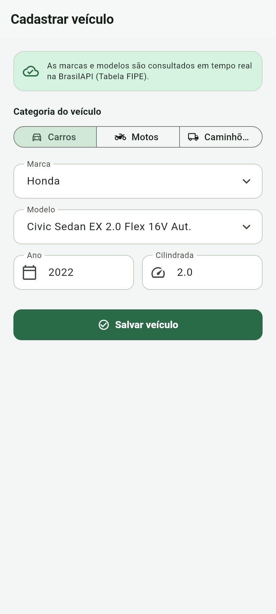
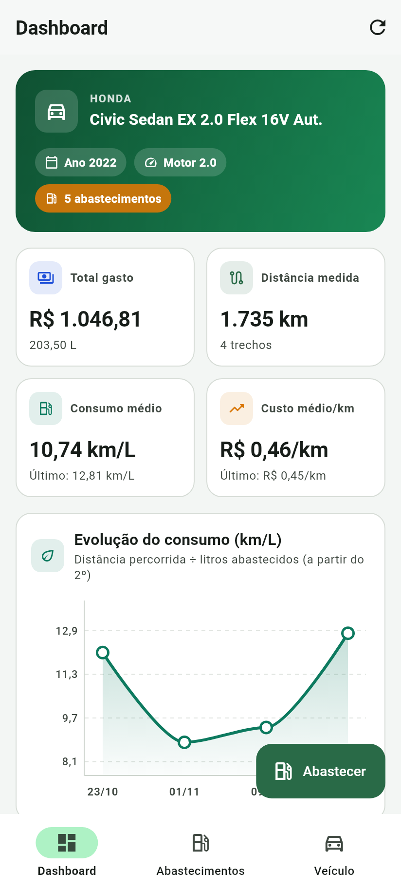
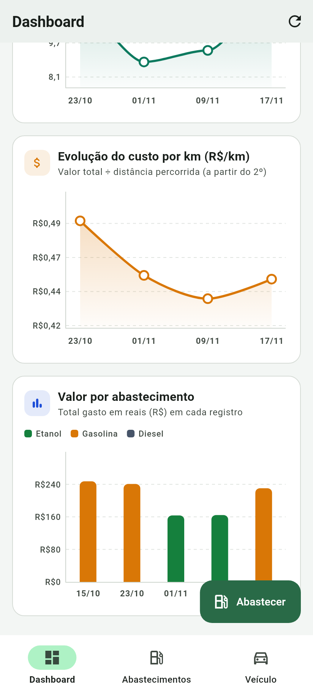
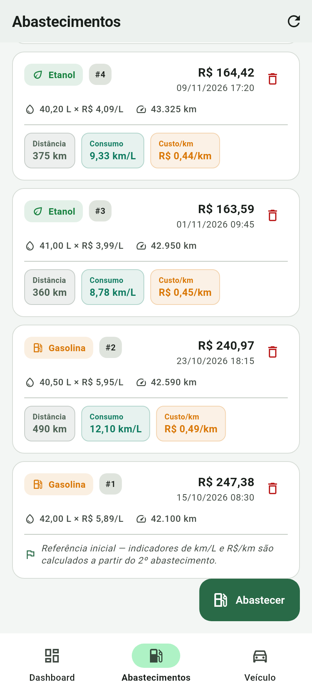
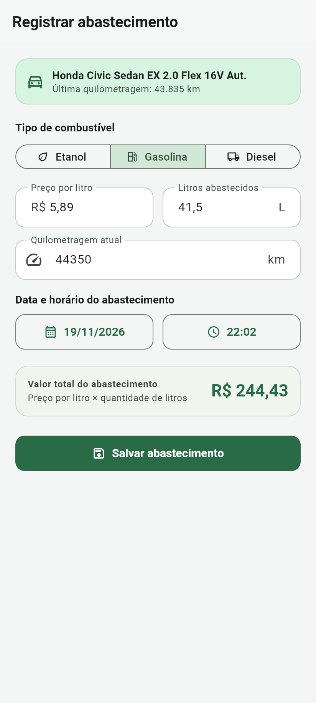
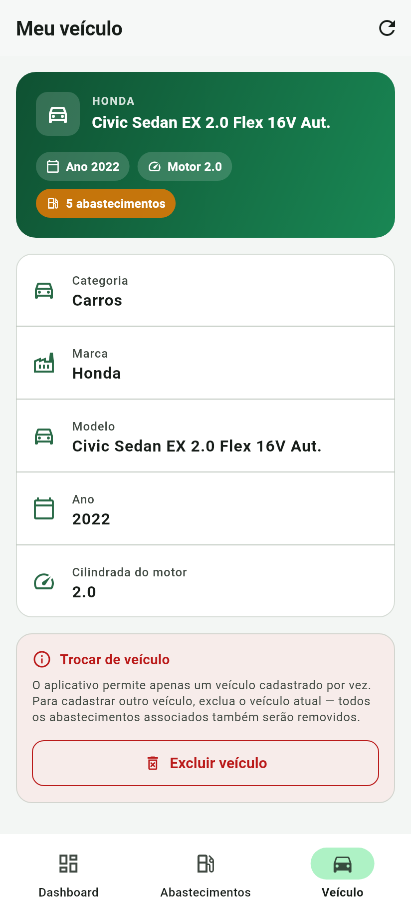

# Controle de Gastos com Combustível
**Atividade Substitutiva da Prova 1 — Programação para Dispositivos Móveis II**  
**Fatec — Prof. Arley**

---

## 👤 Aluno
* **Gustavo Silva** (Modalidade individual)

---

## 📱 Descrição do Aplicativo

Aplicativo móvel desenvolvido em **Flutter** e **Dart** para registrar abastecimentos de um veículo e acompanhar a evolução dos gastos com combustível, do consumo médio (**km/L**) e do custo por quilômetro rodado (**R$/km**) ao longo do tempo.

### Principais Funcionalidades
1. **Cadastro de Veículo (com consulta à BrasilAPI – Tabela FIPE)**:
   * Permite cadastrar **apenas um veículo por vez**, contendo **Marca**, **Modelo**, **Ano** e **Cilindrada do motor** (com suporte às categorias *Carros*, *Motos* e *Caminhões*).
   * As listas de **marcas** e **modelos** são obtidas dinamicamente da **BrasilAPI**, filtrando automaticamente os modelos conforme a marca escolhida, com seletor pesquisável em modal.
   * Para trocar de veículo, o usuário deve excluir o veículo atual mediante confirmação explícita, removendo automaticamente todos os abastecimentos vinculados a ele.
2. **Registro de Abastecimentos**:
   * Registra **tipo de combustível** (*Etanol*, *Gasolina* ou *Diesel*), **preço por litro (R$)**, **quilometragem**, **quantidade de litros** e **data/horário** (com seletores localizados em `pt_BR`).
   * Calcula em tempo real o **valor total** (`preço por litro × litros`) e valida a consistência cronológica da quilometragem.
3. **Persistência Local (SQLite)**:
   * Todos os dados do veículo e dos abastecimentos ficam salvos localmente no banco `controle_combustivel.db` (`sqflite`), com integridade referencial (`ON DELETE CASCADE`) e permanência após fechar e reabrir o aplicativo.
4. **Dashboard e Gráficos Interativos (`fl_chart`)**:
   * **Cartões de Indicadores (KPIs)**: total gasto, distância percorrida medida, consumo médio (`km/L`) e custo médio (`R$/km`).
   * **Regra do 1º abastecimento**: todos os abastecimentos representam tanque cheio; o **primeiro registro atua como referência inicial** (sem indicadores de `km/L` ou `R$/km`).
   * **A partir do 2º abastecimento**, o aplicativo calcula:
     * `Distância percorrida = quilometragem atual − quilometragem anterior`
     * `Consumo (km/L) = distância percorrida ÷ litros do abastecimento atual`
     * `Custo (R$/km) = valor total do abastecimento atual ÷ distância percorrida`
   * **Gráficos interativos**:
     * **Evolução do Consumo (km/L)** — gráfico de linha com gradiente e tooltips.
     * **Evolução do Custo por Quilômetro (R$/km)** — gráfico de linha com gradiente e tooltips.
     * **Valor por Abastecimento (R$)** — gráfico de barras colorido por tipo de combustível.

---

## 📸 Capturas de Tela

| Cadastro de Veículo (BrasilAPI FIPE) | Dashboard — KPIs e Evolução do Consumo | Dashboard — Custo/km e Valor por Abastecimento |
| :---: | :---: | :---: |
|  |  |  |

| Histórico de Abastecimentos | Registrar Abastecimento | Meu Veículo (Detalhes e Exclusão) |
| :---: | :---: | :---: |
|  |  |  |

---

## 🌐 API Pública Utilizada

* **[BrasilAPI — Tabela FIPE](https://brasilapi.com.br/docs#tag/FIPE)**
  * **Listar marcas por categoria**:
    `GET https://brasilapi.com.br/api/fipe/marcas/v1/{tipoVeiculo}`  
    *(onde `{tipoVeiculo}` pode ser `carros`, `motos` ou `caminhoes`)*
  * **Listar modelos da marca selecionada**:
    `GET https://brasilapi.com.br/api/fipe/veiculos/v1/{tipoVeiculo}/{codigoMarca}`

---

## 📦 Bibliotecas Adotadas

| Biblioteca | Finalidade |
| --- | --- |
| [`fl_chart`](https://pub.dev/packages/fl_chart) (`^1.3.1`) | Renderização dos gráficos interativos de linha (`km/L` e `R$/km`) e barras (`R$` por abastecimento) no dashboard. |
| [`http`](https://pub.dev/packages/http) (`^1.6.0`) | Requisições HTTP REST para consultar marcas e modelos na BrasilAPI. |
| [`sqflite`](https://pub.dev/packages/sqflite) (`^2.4.1`) | Persistência local em banco de dados SQLite (`controle_combustivel.db`). |
| [`path`](https://pub.dev/packages/path) (`^1.9.1`) | Montagem segura do caminho do arquivo do banco de dados local. |
| `flutter_localizations` | Tradução de componentes Material (como seletores de data/hora) para `pt_BR`. |
| [`sqflite_common_ffi`](https://pub.dev/packages/sqflite_common_ffi) *(dev)* | Execução dos testes automatizados de persistência SQLite em ambiente desktop/CI. |
| [`flutter_lints`](https://pub.dev/packages/flutter_lints) *(dev)* | Padronização e análise estática com `flutter analyze`. |

---

## 🏗️ Estrutura do Projeto

```
lib/
├── main.dart
├── app.dart
├── core/
│   ├── theme/
│   │   └── app_theme.dart
│   └── utils/
│       └── formatadores.dart
└── features/
    └── combustivel/
        ├── models/
        │   ├── abastecimento.dart
        │   ├── indicador_abastecimento.dart
        │   ├── marca_fipe.dart
        │   ├── modelo_fipe.dart
        │   ├── tipo_combustivel.dart
        │   ├── tipo_veiculo_fipe.dart
        │   └── veiculo.dart
        ├── data/
        │   ├── database/
        │   │   └── banco_combustivel.dart
        │   └── repositories/
        │       └── repositorio_combustivel.dart
        ├── services/
        │   ├── brasil_api_fipe_service.dart
        │   └── calculadora_indicadores.dart
        └── presentation/
            ├── screens/
            │   ├── aba_abastecimentos.dart
            │   ├── aba_dashboard.dart
            │   ├── aba_veiculo.dart
            │   ├── tela_cadastro_veiculo.dart
            │   ├── tela_principal.dart
            │   └── tela_registro_abastecimento.dart
            └── widgets/
                ├── card_kpi.dart
                ├── card_veiculo_resumo.dart
                ├── grafico_evolucao.dart
                ├── grafico_valores.dart
                ├── item_abastecimento.dart
                └── seletor_pesquisavel.dart
test/
├── brasil_api_fipe_service_test.dart
├── calculadora_indicadores_test.dart
├── fluxo_app_test.dart
└── persistencia_test.dart
```

---

## 🚀 Instruções para Executar o Projeto

### Pré-requisitos
* **Flutter SDK** (3.27 ou superior / Dart `>=3.6.0`)
* Emulador Android/iOS configurado ou dispositivo físico com depuração USB ativada
* Conexão com a internet para consultar as marcas e modelos na BrasilAPI

### Passo a passo
1. Clone o repositório:
   ```bash
   git clone https://github.com/GustavoReis-xml/controle-combustivel.git
   cd controle-combustivel
   ```
2. Instale as dependências:
   ```bash
   flutter pub get
   ```
3. Execute a análise estática e os testes automatizados:
   ```bash
   flutter analyze
   flutter test
   ```
4. Execute o aplicativo no dispositivo ou emulador conectado:
   ```bash
   flutter run
   ```
